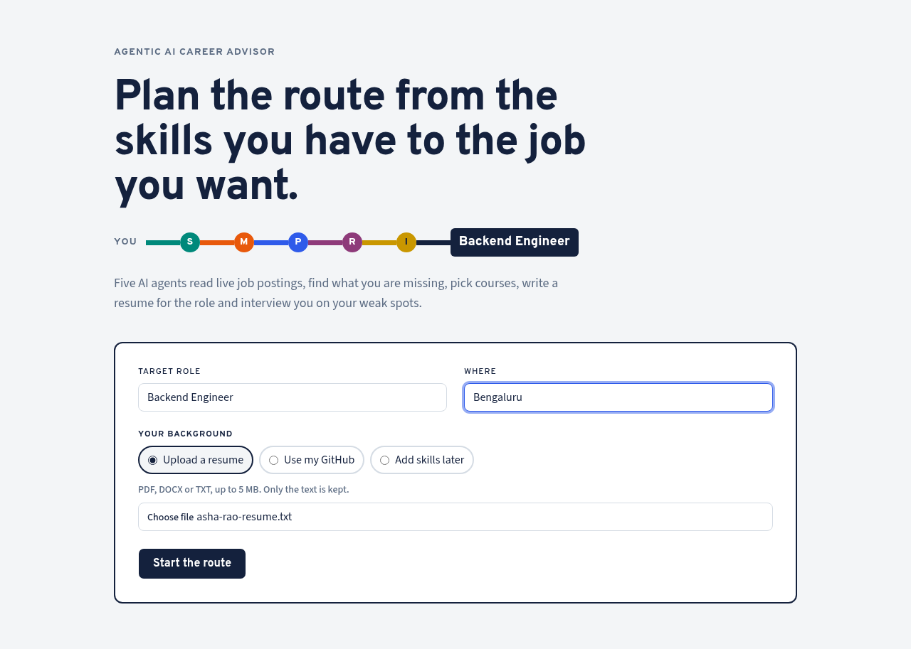
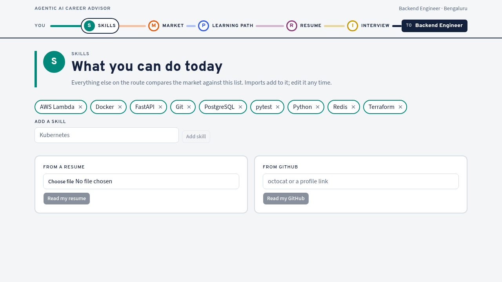
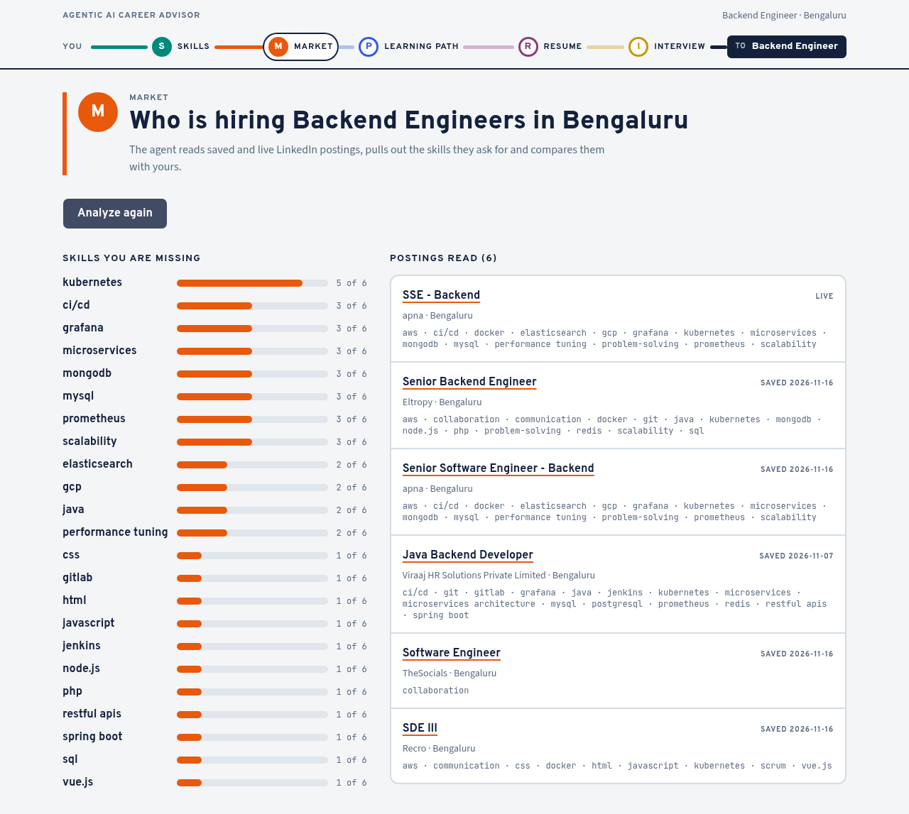
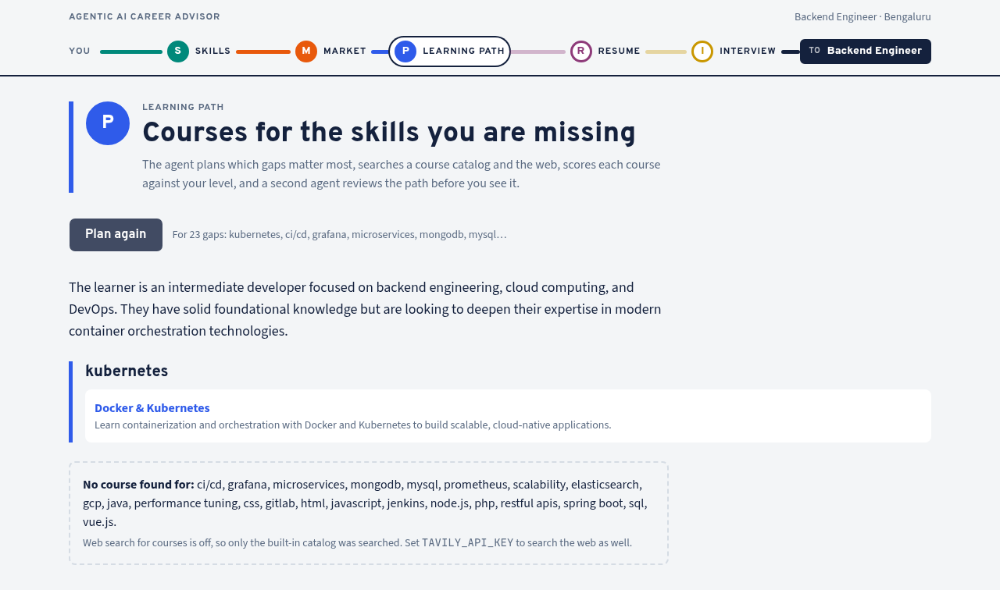
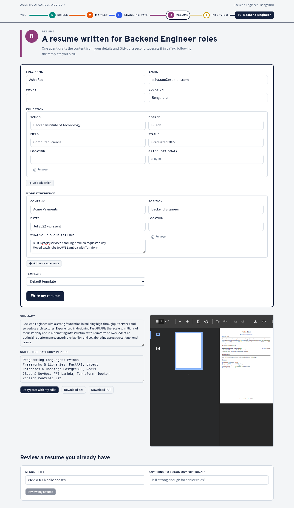
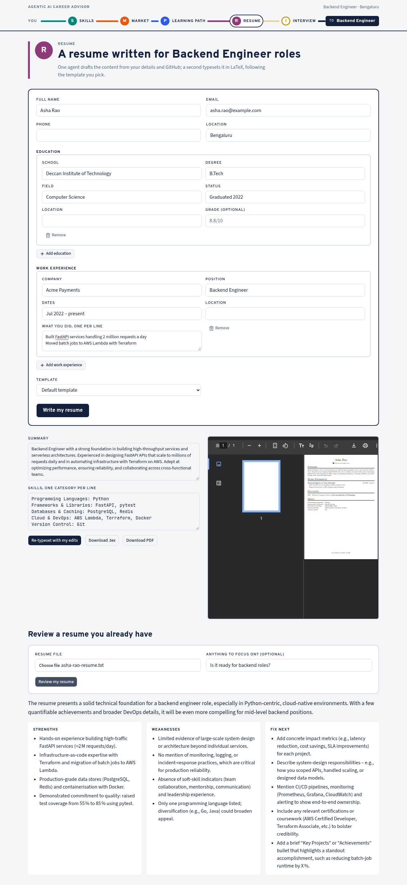
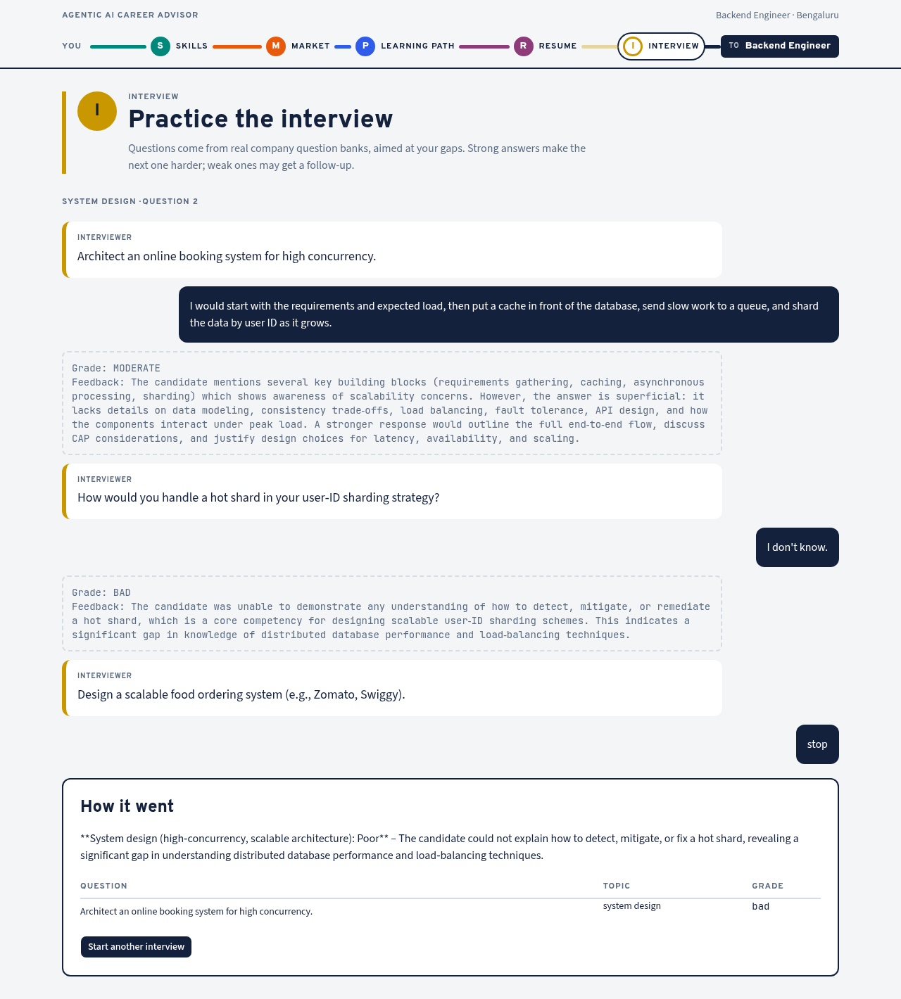
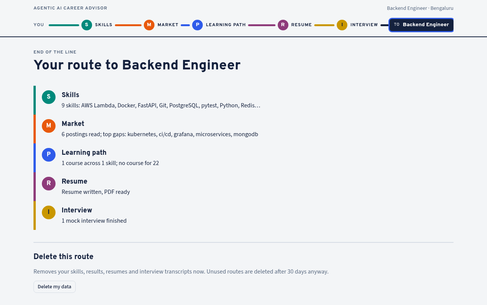
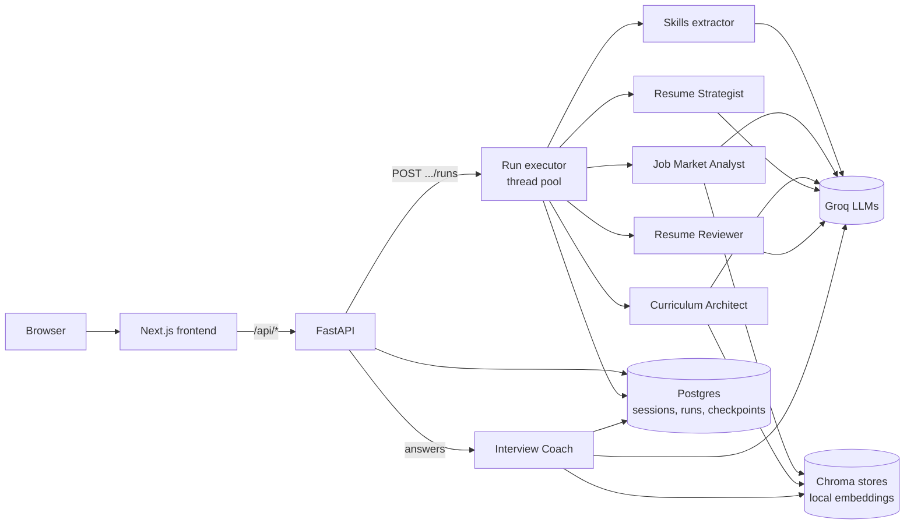

# Agentic AI Career Advisor

**A Multi-Agent System for Personalized Career Guidance**

The **Agentic AI Career Advisor** is an intelligent system designed to provide end-to-end career support. Powered by **Groq** for high-speed inference and **LangGraph** for stateful multi-agent orchestration, the application deploys a team of specialized AI agents to analyze job markets, craft resumes, and prepare candidates for interviews.

## Demo

One real run through every agent, with a fictional candidate (Asha Rao, a backend engineer
in Bengaluru): skills from her resume, the job market, a learning path, a resume and its
review, a mock interview and the report. Click a screenshot for the full page.

https://github.com/user-attachments/assets/c470269c-aee3-47ef-9ca6-11b10789c66c

<table>
<tr><td width="50%"><a href="docs/screenshots/01-start.png"></a><br>Start: role, place and a resume</td><td width="50%"><a href="docs/screenshots/02-skills.png"></a><br>Skills read from the resume</td></tr>
<tr><td width="50%"><a href="docs/screenshots/03-market.png"></a><br>Live LinkedIn postings and skill gaps</td><td width="50%"><a href="docs/screenshots/04-learning-path.png"></a><br>Courses for the gaps</td></tr>
<tr><td width="50%"><a href="docs/screenshots/05-resume.png"></a><br>A resume written for the role, as PDF</td><td width="50%"><a href="docs/screenshots/06-resume-review.png"></a><br>Review of an existing resume</td></tr>
<tr><td width="50%"><a href="docs/screenshots/07-interview.png"></a><br>Mock interview with feedback</td><td width="50%"><a href="docs/screenshots/08-report.png"></a><br>The report</td></tr>
</table>

## How it works

You choose which agent runs next, by picking a station in the web app (or a menu item in the
terminal front-end), and the app calls that agent directly. The agents share what they found
through the session: skills found from a resume feed the job market analysis, its skill gaps
feed the learning path and the interview topics, and the report gathers everything.



Long agent work runs in the background as a *run*: the API answers `202` at once, the agent
writes its progress to the run, and the browser follows it live over server-sent events.
The interview is different, since it waits for you: LangGraph pauses the graph at each
question and keeps its state in Postgres until your answer arrives.

## The agents

All live in `backend/app/agents/`.

| Agent | What it does | File |
| :--- | :--- | :--- |
| **Skills extractor** | Reads your skills from a resume (PDF, DOCX or text) or your public GitHub repositories, falling back to a keyword matcher if the model fails. | `skills.py` |
| **Job Market Analyst** | Searches cached job postings, scrapes fresh ones from LinkedIn and caches them, then compares the skills they ask for with yours to find the gaps, most in demand first. | `job_market_analyst.py` |
| **Curriculum Architect** | For each gap, searches a course catalog (and the web if the catalog has nothing), scores the courses, builds a learning path and has a critic review it, revising up to twice. Gaps with no course are reported, not hidden. | `curriculum_architect.py` |
| **Resume Strategist** | Writes a resume for the target role as a structured draft, then as LaTeX following a reference template, compiled to PDF. | `resume_strategist.py` |
| **Resume Reviewer** | Reviews a resume you already have for the target role: strengths, weaknesses and specific fixes. | `resume_reviewer.py` |
| **Interview Coach** | Runs a mock interview on topics from your skill gaps, using question banks for seven companies plus a general one. Difficulty adapts per topic, weak answers can get a follow-up, and you get a report at the end. | `interview_coach.py` |

## Tech stack

  * **Agents:** LangGraph and LangChain, Python 3.12 (uv)
  * **Language models:** Groq: gpt-oss-120b for the agents, gpt-oss-20b for resume writing (see [Language models](#language-models))
  * **Embeddings:** Google EmbeddingGemma 300M, 4-bit ONNX, run locally on the CPU (see [Embedding model](#embedding-model))
  * **Search:** ChromaDB, with optional Cohere reranking and Tavily web search
  * **API:** FastAPI, with server-sent events for progress
  * **Database:** PostgreSQL (SQLAlchemy 2 and Alembic; LangGraph checkpoints)
  * **Frontend:** Next.js, TypeScript, Tailwind, shadcn/ui, TanStack Query
  * **Resumes:** LaTeX, compiled with `pdflatex` in a sandbox
  * **Deployment:** Docker Compose; GitHub Actions for CI
  * **Evals:** a custom harness over the agents' own prompts, with Gemini as an independent judge (see [Language models](#language-models))

## Language models

The agents run on Groq. Which model does which job was decided by evals on the app's own
tasks, not by guesswork: 12 tasks, one for each place an agent calls a model, each run
through the agent's real prompt and parser with the candidate model swapped in. The full
write-up, with every model tried, the method and its limits, is in
**[docs/EVALS.md](docs/EVALS.md)**.

| Used for | Model | Why |
| :--- | :--- | :--- |
| Every agent except resume writing | `openai/gpt-oss-120b`, medium reasoning | Best or tied best on skill extraction (14/15), answer grading (0.88 against 0.72 for 20b), follow-up decisions (21/24), course parsing (6/6) and the full curriculum graph |
| Resume draft and LaTeX | `openai/gpt-oss-20b`, low reasoning | As good as 120b on resumes at half the price; 120b at medium skipped the required tool call on 5 of 6 drafts |

Both can be changed with `LLM_MODEL`, `RESUME_LLM_MODEL` and their `*_REASONING_EFFORT`
settings (see `.env.example`).

### Results

Four setups, 3 runs each (2 for 20b at medium).
Cells are passed/scored cases summed over the runs. The floor is the best that a constant
answer ("always approve", "always moderate") gets, so a score means something only above it.

| Task | What passes | Floor | 20b low | 120b low | 20b medium | 120b medium |
| :--- | :--- | :--- | :--- | :--- | :--- | :--- |
| skill_extraction | No skill missed, at most one extra | | 9/15 | 9/15 | 7/10 | **14/15** |
| template_tagging | Right tags for a CV, none forbidden | 7/15 | 39/45 | **42/45** | 25/30 | 39/45 |
| answer_grading (mean score) | Exact grade 1, one step off 0.5 | 0.50 | 0.72 | **0.88** | 0.75 | **0.88** |
| follow_up_decision | Follow up or move on, as labelled | 4/8 | 18/24 | 18/24 | 8/16 | **21/24** |
| follow_up_question | Judge; one question, no praise | | 4/4 | 4/4 | 4/4 | 4/4 |
| interview_summary | Judge; faithful, covers each topic | | 2/2 | 2/2 | 1/1 | 2/2 |
| curriculum_planner | Every gap found, none invented | | 9/9 | 9/9 | 6/6 | 9/9 |
| course_parsing | Real courses kept, junk dropped, no invented URLs | | 3/6 | **6/6** | 1/4 | **6/6** |
| curriculum_critic | Approve or reject, as labelled | 4/8 | **21/24** | 18/24 | 15/16 | 19/24 |
| curriculum_end_to_end | Whole graph: gaps covered, catalog URLs only | | 4/6 | 4/6 | 2/4 | 4/6 |
| resume_generation | Facts kept, nothing invented, compiles; judge | | **1/2** | **1/2** | 0/2 | 1/6 |
| resume_review | Judge; grounded, specific, actionable | | 2/2 | 2/2 | 0/3 | 2/2 |

A model per agent would gain little (the critic 21/24 instead of 19/24 on 20b low, tagging
42/45 instead of 39/45 on 120b low) for five settings instead of two. Cost did not decide it:
one full run of every task costs under $0.01 on any setup.

### How the scoring was kept honest

- **Hand-checked labels** written for this app: answers written at known quality, CVs with
  required and forbidden tags, critic cases with a clear right verdict.
- **An independent judge** for open-ended text: Gemini, a different model family from every
  candidate, blind to which model wrote the output. Before its scores counted, it had to tell
  deliberately bad outputs from good ones (it scored good 0.92 to 1.00, bad 0.00 to 0.06). A
  judged case fails if any single criterion scores below 3 of 5, so a polished resume with
  one invented achievement fails.
- **Fallbacks score zero.** The agents recover from errors with defaults (a default grade,
  "Let's move on", a keyword matcher); the evals count those as failures, not passes.
- **Only the model's own decisions count.** After "I don't know" the app moves on by itself,
  so those cases are left unscored rather than credited to the model.
- **Reproducible.** Each results file records the commit, models, prices, judge model and a
  fingerprint of every label file. The harness has 160 offline tests of its own.

### What the evals found

- **More reasoning is not always better.** 20b at medium broke structured output on most
  resume and review calls, and 120b at medium answered in plain text instead of calling the
  resume tool.
- **gpt-oss-20b grades to the extremes:** moderate answers become "bad" and good ones
  "excellent". 120b's misses are one grade off.
- **Some failures were the prompt's, not the model's.** Every model asked a follow-up after
  "I don't know", so the app now moves on from non-answers itself. On the 16 decision cases
  that remain, 120b at medium scores 30/36 and 20b at low 18/36 (floor 6/12 per run): 20b
  follows up after everything, while 120b moves on from every wrong answer, even the two on
  the right track, so it decides by the grade more than by the answer.
- **Also tried:** Qwen 3.8 27B tagged templates well but kept breaking tool calls, at 5 to
  10 times the price of gpt-oss, so it was dropped. Llama 3.3 70B, the app's first default,
  was retired by Groq before the evals began.

## Embedding model

Job postings, courses and interview questions are found by meaning, not keywords, using
[EmbeddingGemma 300M](https://huggingface.co/google/embeddinggemma-300m) from Google. It runs on
your own CPU, so searches cost nothing, need no API key and send no data anywhere.

The app uses the 4-bit [ONNX build](https://huggingface.co/onnx-community/embeddinggemma-300m-ONNX)
through ONNX Runtime, without PyTorch. That keeps the backend image around 2.6 GB instead of
about 4.6 GB, and the model needs no Hugging Face token. The full 768 dimensions are kept.

### How it was chosen

Candidate models were scored on the app's own data (457 job postings, 578 interview questions
and 23 courses) with 46 searches phrased the way the agents search. The score is nDCG, from 0 to
1: how close the top results come to the ideal order, averaged over the three tasks.

| Model | Dimensions | Score |
| :--- | ---: | ---: |
| EmbeddingGemma, full precision | 768 | 0.860 |
| **EmbeddingGemma, 4-bit ONNX (used)** | 768 | **0.858** |
| EmbeddingGemma, 8-bit ONNX | 768 | 0.855 |
| EmbeddingGemma, full precision | 512 | 0.847 |
| EmbeddingGemma, full precision | 256 | 0.816 |
| BGE base v1.5 | 768 | 0.814 |
| BGE small v1.5 | 384 | 0.781 |
| EmbeddingGemma without its task prompts | 768 | 0.764 |
| all-MiniLM-L6-v2 | 384 | 0.761 |
| Snowflake Arctic Embed M v1.5 | 768 | 0.711 |

Two findings shaped the setup:

* **Task prompts matter.** EmbeddingGemma expects queries to start with
  `task: search result | query: ` and documents with `title: none | text: `. Without them it
  scored 0.764 instead of 0.860; the app adds both.
* **4-bit costs no search quality here.** It scored the same as full precision while using
  about a sixth of the disk space. Its vectors are 0.97 cosine-similar to the full-precision
  ones on average (two unrelated texts score about 0.60).

### Safety

The ONNX conversion is published by the Hugging Face community organisation, not by Google, so
the app does not trust it blindly:

* It downloads one fixed commit (`5090578d`), so later changes to the repository never reach you.
* Before loading, it checks every file against a SHA-256 fingerprint stored in
  `backend/app/core/embeddings.py`. A file that does not match is deleted and the app stops with
  an error instead of running it.
* The pinned files were compared with Google's original model on all 1,104 test texts. Every
  vector pointed the same way as the original's, with no outliers.

### Resources

Loading the model takes about 0.5 GB of RAM; embedding long job postings peaks at about 0.8 GB
for the whole process. It embeds about 7 job postings a second on a laptop CPU.

### Upgrading from an older version

Earlier versions built the vector stores with a different setup of the model, and the old and
new vectors cannot be mixed. Delete the old stores once and seed again:

```bash
cd backend
rm -rf data/chroma_market data/chroma_courses data/chroma_interview
uv run python -m app.agents.ingestion.seed_interview_db
```

The course catalog is rebuilt on first use. Cached job postings are scraped again as you search.

## Quick start with Docker

You need Docker with Compose, a [Groq API key](https://console.groq.com/keys), and about
4 GB of free RAM.

```bash
git clone https://github.com/anandn1/career-advisor.git
cd career-advisor
cp .env.example .env          # then set GROQ_API_KEY; the other keys are optional
docker compose up --build
```

Open http://localhost:3000.

The first start takes a few minutes: the backend creates its tables, loads the resume
templates and builds the interview question store before it reports healthy, and the web app
waits for it. Follow along with `docker compose logs -f backend`. Later starts skip this.

What runs:

| Service | What it is |
| :--- | :--- |
| `frontend` | Next.js on port 3000, the only port published. It forwards `/api/*` to the backend, so one address serves everything. |
| `backend` | FastAPI with the agents, the embedding model (built into the image and checked against its fingerprints) and TeX Live for PDF resumes. |
| `postgres` | Postgres 17 for sessions, runs, resume templates and interview checkpoints. |

Data lives in two Docker volumes, `postgres-data` and `backend-data` (search stores and generated
files), so it survives restarts. `docker compose down -v` deletes it. To serve the app on another
port, set `PORT` in your `.env`.

## Local development setup

### Prerequisites

  * [uv](https://docs.astral.sh/uv/) (installs Python 3.12 for you)
  * PostgreSQL
  * A Groq API key
  * Optional: Cohere (reranking), Tavily (course search) and GitHub (rate limits) keys
  * Optional: TeX Live (`pdflatex`) to compile resumes to PDF; without it you get the `.tex` file

### 1. Clone and install

```bash
git clone https://github.com/anandn1/career-advisor.git
cd career-advisor/backend
uv sync
```

The first search downloads the embedding model (about 200 MB) into `backend/data/models/`.

### 2. Configure

Copy `.env.example` to `.env` in the repository root and fill in at least `GROQ_API_KEY` and `DATABASE_URL`.

### 3. Prepare the databases (from `backend/`)

```bash
uv run alembic upgrade head                              # Postgres tables
uv run python -m app.db.seed_templates                   # resume templates
uv run python -m app.agents.ingestion.seed_interview_db  # interview question store
```

## Usage

### Web app

Start the API from `backend/`:

```bash
uv run uvicorn app.main:create_app --factory --reload   # http://localhost:8000 (docs at /docs)
```

Then start the frontend from `frontend/` (Node 22 and pnpm):

```bash
cp .env.example .env.local     # NEXT_PUBLIC_API_URL=http://localhost:8000
pnpm install
pnpm dev                       # http://localhost:3000
```

Open http://localhost:3000, enter a target role and location, and add your background from a resume or GitHub. The route bar at the top takes you through the stations: Skills, Market, Learning path, Resume and Interview, ending at the Report. While an agent runs, its steps light up live on a line of stops.

Run only one API process: at startup it marks interrupted runs as failed.

### Terminal

```bash
cd backend && uv run python -m app.cli
```

### Recording the demo

With the app running (`docker compose up`), this drives every station with real agents,
saves the screenshots above to `docs/screenshots/` and writes the video, with long agent
waits sped up and labelled, to `frontend/recording/output/career-advisor-demo.mp4`:

```bash
cd frontend && pnpm exec playwright install chromium   # once
APP_URL=http://localhost:3000 pnpm record
```

### Tests and checks

```bash
cd backend && uv run pytest                                # backend tests, offline (no keys, network or Postgres)
cd backend && uv run ruff check app migrations tests evals # backend lint
cd frontend && pnpm test                                   # frontend tests (Vitest)
cd frontend && pnpm lint && pnpm typecheck                 # frontend lint and types
```

CI runs all of these on every pull request, plus `ruff format --check` and a production
build, and builds both Docker images. The model evals call real models and cost money, so
they run by hand; see [backend/evals/README.md](backend/evals/README.md).

## API

Everything lives under `/api/v1`, and the full reference is at `/docs` on the backend
(Swagger UI). A session holds one person's role, location and skills; knowing its UUID is the
only access control, and sessions unused for 30 days are deleted (`SESSION_TTL_DAYS`).

| Method and path | What it does |
| :--- | :--- |
| `POST /sessions` | Start a session with a target role and location |
| `GET`, `PATCH`, `DELETE /sessions/{id}` | Read, change or delete it |
| `POST /sessions/{id}/runs` | Start an agent run. JSON with a `kind`: `job_market`, `learning_path`, `skills_from_github`, `resume` or `resume_render`. The two that take a file, `skills_from_resume` and `resume_review`, send a multipart form with `kind` and `file`. One unfinished run per kind (409 otherwise). |
| `GET /sessions/{id}/runs[/{run_id}]` | List runs, or read one with its result |
| `GET /sessions/{id}/runs/{run_id}/events` | Follow a run's progress (server-sent events; `Last-Event-ID` resumes) |
| `GET /sessions/{id}/runs/{run_id}/resume?format=pdf\|tex` | Download a written resume |
| `GET /sessions/{id}/interview-topics?company_focus=` | Topics that have questions for that company, and the ones suggested by your skill gaps |
| `POST /sessions/{id}/interviews` | Start a mock interview; `POST .../{interview_id}/answers` answers it |
| `GET /sessions/{id}/report` | Everything found so far, in one place |
| `GET /templates` | The LaTeX resume templates |

## Project structure

```text
compose.yaml         # Docker stack: frontend, backend, postgres
frontend/            # Next.js + TypeScript + Tailwind web app (shadcn/ui, TanStack Query)
├── src/             # app routes, stations, API client (types generated from openapi.json)
└── recording/       # Playwright script that records the demo
backend/
├── app/
│   ├── agents/      # LangGraph agents, their seed data and the interview question files
│   ├── core/        # settings, shared LLM/embeddings/vector stores, checkpointer
│   ├── services/    # run executor and handlers, job scraper, GitHub, documents, LaTeX
│   ├── api/         # FastAPI routers and schemas
│   ├── db/          # SQLAlchemy models, queries, template seeding
│   ├── main.py      # FastAPI app factory
│   └── cli.py       # terminal front-end
├── evals/           # model evals (see evals/README.md)
├── tests/           # pytest suite, offline
├── migrations/      # Alembic migrations
├── templates/       # reference LaTeX resume templates
└── pyproject.toml
docs/                # SRS, the eval write-up (EVALS.md) and the demo screenshots
.github/workflows/   # CI: lint, tests, typecheck, Docker image builds
```

## Roadmap

  - [x] Core agentic workflow (CLI) with LangGraph
  - [x] Local embeddings (EmbeddingGemma 300M, 4-bit ONNX)
  - [x] Web app: FastAPI backend and Next.js frontend
  - [x] Sessions, runs and interviews kept in Postgres
  - [x] Docker Compose deployment and CI
  - [x] Evals for choosing the models
  - [ ] Follow-up decisions that weigh the answer, not only its grade
  - [ ] Course links checked before they are shown
  - [ ] Non-Latin scripts in PDF resumes

## Project Context

This project was developed as part of the **"Agentic AI"** course at **IIIT Raichur**, under the guidance of **Dr. Sunil Saumya** of **IIIT Dharwad**.

## License

Distributed under the MIT License. See `LICENSE` for more information.


