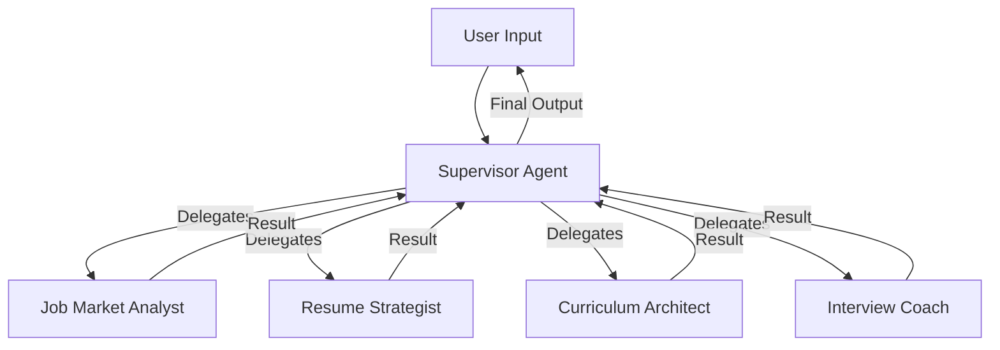

# Agentic AI Career Advisor

**A Multi-Agent System for Personalized Career Guidance**

The **Agentic AI Career Advisor** is an intelligent system designed to provide end-to-end career support. Powered by **Groq** for high-speed inference and **LangGraph** for stateful multi-agent orchestration, the application deploys a team of specialized AI agents to analyze job markets, craft resumes, and prepare candidates for interviews.

> **Current Status:** The agents run from a terminal front-end. A web interface (FastAPI + Next.js) and Docker deployment are in development.

## System Architecture

The system operates via a supervised graph workflow where a **Supervisor Agent** delegates tasks to specialized sub-agents based on the user's state and needs.



## The Agent Team

| Agent | Role | File |
| :--- | :--- | :--- |
| **Job Market Analyst** | Scans job descriptions to identify critical skills and market trends. | `job_market_analyst.py` |
| **Resume Strategist** | Structures and optimizes user profiles for ATS compatibility and impact. | `resume_strategist.py` |
| **Curriculum Architect** | Identifies skill gaps and recommends personalized learning resources. | `curriculum_architect.py` |
| **Interview Coach** | Conducts mock interviews tailored to the specific target role. | `interview_coach.py` |

## Tech Stack

  * **Orchestration:** LangGraph (Stateful multi-agent workflows)
  * **LLM Engine:** Groq (Llama 3 / Mixtral for near-instant inference)
  * **Embeddings:** Google EmbeddingGemma 300M (Running locally via SentenceTransformers)
  * **Framework:** Python, LangChain
  * **Database:** PostgreSQL (SQLAlchemy + Alembic; LangGraph checkpoints)
  * **Vector Store:** ChromaDB (for RAG capabilities)

## Installation & Setup

### Prerequisites

  * [uv](https://docs.astral.sh/uv/) (installs Python 3.12 for you)
  * PostgreSQL
  * A Groq API key, and a Hugging Face token with access to `google/embeddinggemma-300m`
  * Optional: Cohere (reranking), Tavily (course search) and GitHub (rate limits) keys
  * Optional: TeX Live (`pdflatex`) to compile resumes to PDF; without it you get the `.tex` file

### 1. Clone and install

```bash
git clone https://github.com/anandn1/career-advisor.git
cd career-advisor/backend
uv sync
```

The first run downloads the EmbeddingGemma weights (about 300 MB).

### 2. Configure

Copy `.env.example` to `.env` in the repository root and fill in at least `GROQ_API_KEY` and `DATABASE_URL`.

### 3. Prepare the databases (from `backend/`)

```bash
uv run alembic upgrade head                              # Postgres tables
uv run python -m app.db.seed_templates                   # resume templates
uv run python -m app.agents.ingestion.seed_interview_db  # interview question store
```

## Usage

Start the terminal front-end from `backend/`:

```bash
uv run python -m app.cli
```

It asks for your target role, location and a resume file or GitHub username, then accepts commands: `jobs`, `learn`, `resume`, `interview`, `skills`, `report` and `exit`. Generated resumes and reports are saved in `backend/data/outputs/`.

## Project Structure

```text
backend/
├── app/
│   ├── agents/      # LangGraph agents: skills, job market, curriculum, resume, interview
│   ├── core/        # settings, shared LLM/embeddings/vector stores, checkpointer
│   ├── services/    # job scraper, GitHub client, document reading, LaTeX compile
│   ├── db/          # SQLAlchemy models, queries, template seeding
│   └── cli.py       # terminal front-end
├── migrations/      # Alembic migrations
├── templates/       # reference LaTeX resume templates
└── pyproject.toml
docs/                # SRS and architecture diagram
```

## Roadmap

  - [x] Core Agentic Workflow (CLI) with LangGraph
  - [x] Integration of Local Embeddings (Gemma 300M)
  - [ ] Web interface: FastAPI backend + Next.js frontend
  - [ ] Database integration for persistent user history.
  - [ ] Enhanced error handling and retry mechanisms.

## Project Context

This project was developed as part of the **"Agentic AI"** course at **IIIT Raichur**, under the guidance of **Dr. Sunil Saumya** of **IIIT Dharwad**.

## License

Distributed under the MIT License. See `LICENSE` for more information.


