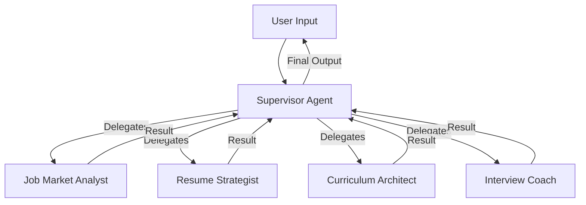

# Agentic AI Career Advisor

**A Multi-Agent System for Personalized Career Guidance**

The **Agentic AI Career Advisor** is an intelligent system designed to provide end-to-end career support. Powered by **Groq** for high-speed inference and **LangGraph** for stateful multi-agent orchestration, the application deploys a team of specialized AI agents to analyze job markets, craft resumes, and prepare candidates for interviews.

> **Current Status:** The web app (FastAPI + Next.js) is working; Docker deployment is in development.

## System Architecture

The system operates via a supervised graph workflow where a **Supervisor Agent** delegates tasks to specialized sub-agents based on the user's state and needs.



## The Agent Team

| Agent | Role | File |
| :--- | :--- | :--- |
| **Job Market Analyst** | Scans job descriptions to identify critical skills and market trends. | `job_market_analyst.py` |
| **Resume Strategist** | Structures and optimizes user profiles for ATS compatibility and impact. | `resume_strategist.py` |
| **Curriculum Architect** | Identifies skill gaps and recommends personalized learning resources. | `curriculum_architect.py` |
| **Interview Coach** | Conducts mock interviews tailored to the specific target role. | `interview_coach.py` |

## Tech Stack

  * **Orchestration:** LangGraph (Stateful multi-agent workflows)
  * **LLM Engine:** Groq (Llama 3 / Mixtral for near-instant inference)
  * **Embeddings:** Google EmbeddingGemma 300M, 4-bit ONNX, run locally on the CPU (see [Embedding model](#embedding-model))
  * **Framework:** Python, LangChain
  * **Database:** PostgreSQL (SQLAlchemy + Alembic; LangGraph checkpoints)
  * **Vector Store:** ChromaDB (for RAG capabilities)

## Embedding model

Job postings, courses and interview questions are found by meaning, not keywords, using
[EmbeddingGemma 300M](https://huggingface.co/google/embeddinggemma-300m) from Google. It runs on
your own CPU, so searches cost nothing, need no API key and send no data anywhere.

The app uses the 4-bit [ONNX build](https://huggingface.co/onnx-community/embeddinggemma-300m-ONNX)
through ONNX Runtime, without PyTorch. That keeps the backend image around 2.6 GB instead of
about 4.6 GB, and the model needs no Hugging Face token. The full 768 dimensions are kept.

### How it was chosen

Candidate models were scored on the app's own data (457 job postings, 578 interview questions
and 23 courses) with 46 searches phrased the way the agents search. The score is nDCG, from 0 to
1: how close the top results come to the ideal order, averaged over the three tasks.

| Model | Dimensions | Score |
| :--- | ---: | ---: |
| EmbeddingGemma, full precision | 768 | 0.860 |
| **EmbeddingGemma, 4-bit ONNX (used)** | 768 | **0.858** |
| EmbeddingGemma, 8-bit ONNX | 768 | 0.855 |
| EmbeddingGemma, full precision | 512 | 0.847 |
| EmbeddingGemma, full precision | 256 | 0.816 |
| BGE base v1.5 | 768 | 0.814 |
| BGE small v1.5 | 384 | 0.781 |
| EmbeddingGemma without its task prompts | 768 | 0.764 |
| all-MiniLM-L6-v2 | 384 | 0.761 |
| Snowflake Arctic Embed M v1.5 | 768 | 0.711 |

Two findings shaped the setup:

* **Task prompts matter.** EmbeddingGemma expects queries to start with
  `task: search result | query: ` and documents with `title: none | text: `. Without them it
  scored 0.764 instead of 0.860; the app adds both.
* **4-bit costs no search quality here.** It scored the same as full precision while using
  about a sixth of the disk space. Its vectors are 0.97 cosine-similar to the full-precision
  ones on average (two unrelated texts score about 0.60).

### Safety

The ONNX conversion is published by the Hugging Face community organisation, not by Google, so
the app does not trust it blindly:

* It downloads one fixed commit (`5090578d`), so later changes to the repository never reach you.
* Before loading, it checks every file against a SHA-256 fingerprint stored in
  `backend/app/core/embeddings.py`. A file that does not match is deleted and the app stops with
  an error instead of running it.
* The pinned files were compared with Google's original model on all 1,104 test texts. Every
  vector pointed the same way as the original's, with no outliers.

### Resources

Loading the model takes about 0.5 GB of RAM; embedding long job postings peaks at about 0.8 GB
for the whole process. It embeds about 7 job postings a second on a laptop CPU.

### Upgrading from an older version

Earlier versions built the vector stores with a different setup of the model, and the old and
new vectors cannot be mixed. Delete the old stores once and seed again:

```bash
cd backend
rm -rf data/chroma_market data/chroma_courses data/chroma_interview
uv run python -m app.agents.ingestion.seed_interview_db
```

The course catalog is rebuilt on first use. Cached job postings are scraped again as you search.

## Installation & Setup

### Prerequisites

  * [uv](https://docs.astral.sh/uv/) (installs Python 3.12 for you)
  * PostgreSQL
  * A Groq API key
  * Optional: Cohere (reranking), Tavily (course search) and GitHub (rate limits) keys
  * Optional: TeX Live (`pdflatex`) to compile resumes to PDF; without it you get the `.tex` file

### 1. Clone and install

```bash
git clone https://github.com/anandn1/career-advisor.git
cd career-advisor/backend
uv sync
```

The first search downloads the embedding model (about 200 MB) into `backend/data/models/`.

### 2. Configure

Copy `.env.example` to `.env` in the repository root and fill in at least `GROQ_API_KEY` and `DATABASE_URL`.

### 3. Prepare the databases (from `backend/`)

```bash
uv run alembic upgrade head                              # Postgres tables
uv run python -m app.db.seed_templates                   # resume templates
uv run python -m app.agents.ingestion.seed_interview_db  # interview question store
```

## Usage

### Web app

Start the API from `backend/`:

```bash
uv run uvicorn app.main:create_app --factory --reload   # http://localhost:8000 (docs at /docs)
```

Then start the frontend from `frontend/` (Node 22 and pnpm):

```bash
cp .env.example .env.local     # NEXT_PUBLIC_API_URL=http://localhost:8000
pnpm install
pnpm dev                       # http://localhost:3000
```

Open http://localhost:3000, enter a target role and location, and add your background from a resume or GitHub. The route bar at the top takes you through the stations: Skills, Market, Learning path, Resume and Interview, ending at the Report. While an agent runs, its steps light up live on a line of stops.

Run only one API process: at startup it marks interrupted runs as failed.

### Terminal

```bash
cd backend && uv run python -m app.cli
```

### Tests

```bash
cd backend && uv run pytest     # backend, offline
cd frontend && pnpm test        # frontend (Vitest)
```

## Project Structure

```text
frontend/            # Next.js + TypeScript + Tailwind web app (shadcn/ui, TanStack Query)
backend/
├── app/
│   ├── agents/      # LangGraph agents: skills, job market, curriculum, resume, interview
│   ├── core/        # settings, shared LLM/embeddings/vector stores, checkpointer
│   ├── services/    # job scraper, GitHub client, document reading, LaTeX compile
│   ├── api/         # FastAPI routers and schemas
│   ├── db/          # SQLAlchemy models, queries, template seeding
│   ├── main.py      # FastAPI app factory
│   └── cli.py       # terminal front-end
├── migrations/      # Alembic migrations
├── templates/       # reference LaTeX resume templates
└── pyproject.toml
docs/                # SRS and architecture diagram
```

## Roadmap

  - [x] Core Agentic Workflow (CLI) with LangGraph
  - [x] Integration of Local Embeddings (Gemma 300M)
  - [x] Web interface: FastAPI backend + Next.js frontend
  - [ ] Database integration for persistent user history.
  - [ ] Enhanced error handling and retry mechanisms.

## Project Context

This project was developed as part of the **"Agentic AI"** course at **IIIT Raichur**, under the guidance of **Dr. Sunil Saumya** of **IIIT Dharwad**.

## License

Distributed under the MIT License. See `LICENSE` for more information.


